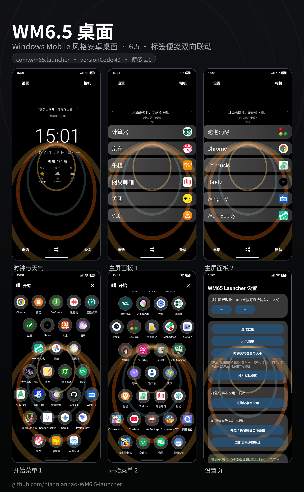

# WM6.5 桌面（Windows Mobile 风格安卓桌面 · 6.5）

把 Windows Mobile 6.5 那套圆形环状图标布局搬到安卓上的桌面启动器（`com.wm65.launcher`），当前版本 **6.5 / versionCode 52**，配套自带「标签记事本」卡片，与自建纯本地便笺 App（`com.msn.localnotes`，便笺 2.0）双向联动。

- 桌面安装包：[6.5/WM6.5桌面.apk](6.5/WM6.5桌面.apk)
- 便笺安装包：[6.5/便签.apk](6.5/便签.apk)
- 完整操作说明：[使用说明.md](使用说明.md)
- 实际界面截图：[截图/](截图/)

## 功能一览

- **Today 页**：大时钟 + 日期 + 天气三日预报 + 每日诗词（自动缩放字号、最长两行、单行居中）
- **四页图标面板**：环状布局的快捷图标与小部件，长按可整体移动，支持缩放与位置微调
- **六项 6.5 改动**：
  1. 版本号直接标 6.5
  2. 标签记事本卡片改读便笺 App 的数据（双向：桌面新建/编辑、便笺里改、桌面即时看到）
  3. 点便签条目进全屏编辑页，点「新建」进全屏新建页并预填 `[分类] `
  4. 便笺编辑页支持分享（`ACTION_SEND` + 系统选择器）
  5. 诗词取消 10 字限制、自适应字号两行内显示
  6. 时钟缺失修复（`buildPages` 空指针守卫 + 重建后重绘时钟）
- **图标装/卸即时刷新**：注册系统 `LauncherApps.Callback` 即时感知安装/卸载，同步重扫后重绘主面板**并刷新应用抽屉**（旧版漏刷抽屉是图标残留、新装不出现的根因），另有 70 秒指纹比对兜底

## 安装

1. **先装便笺，再装桌面**（桌面启动后需要能访问便笺的 Provider）
2. 桌面是重签版本，装之前必须先卸载旧版桌面；卸载会丢失桌面布局、壁纸与旧便笺数据
3. 装好后打开「设置为默认桌面」，否则回桌面手势不会生效

## 目录

| 路径 | 内容 |
|---|---|
| `6.5/` | 6.5 版构建产物（APK、`classes.jar`、`classes/`、`dex/`、`gen/`、`res.zip`、`pack_dex.py`、`sources.txt`） |
| `截图/` | 6.5 实际界面截图 + 条目说明 |
| `使用说明.md` | 按 APK 实际行为写的完整操作说明（含常见问题、已知限制） |
| `WM65Launcher_优化版.apk` | 早期优化版构建 |
| `work/` | 反编译工程、基线包与诊断脚本 |

## 已知限制

- **微软账号同步不可用**：重签后 OAuth 应用注册失败（`AADSTS50011` / `invalid_client`），只能使用本地便笺
- 桌面第三方小部件列表里看不到第三方 AppWidget
- 便笺本身不可卸载，卸载即丢全部便签数据
- 主屏格子上的应用被卸载后该格会空出，需手动重新指定（原版设计如此）
- 系统装/卸广播在这类 ROM 上不可靠，本项目改用 `LauncherApps.Callback` + 指纹比对兜底，同款 ROM 上如仍偶发延迟属系统投递时序

## 说明

本项目为个人自用改造，基于 WM65 Launcher 逆向修改（apktool 反编译 + smali/补丁类注入 + 重签），非官方发布版本。
